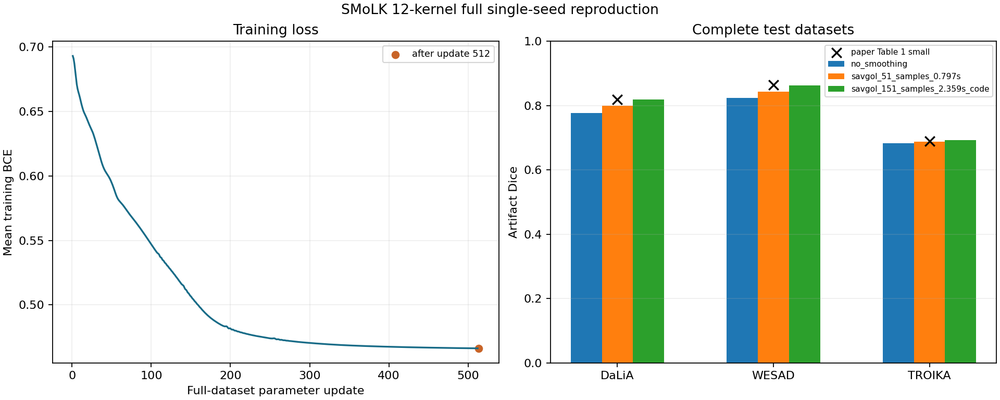

# SMoLK 复现：先对齐评价口径，再比较论文成绩

> 作品展示草稿；仅供私有仓库存档，公开范围待确认。完整实验记录保留于本地研究工程，未随包提供。[返回作品首页](../README.md)

## 研究问题

拿到接近论文的数字之前，需要确认输入、标签、数据划分、后处理和指标是否一致。
论文正文描述 SG 平滑约 0.8 秒，固定代码却使用 151 点。在 64 Hz 下，51 点约 0.797 秒，151 点约 2.359 秒。
本案例检查这一差异，并区分“复现对齐”“均衡识别”和“下游任务收益”。

## 方法与范围

- 方法来源：Chen 等人的 SMoLK，Small PPG 配置；作者提交固定为 4aa63d72d5fedb80bd5ba6a905dcc75f1cafd12a。
- 输入为作者发布的处理后单路 PPG，64 Hz、30 秒、1920 点；192/96/64 点核各 4 个，共 1432 参数。
- 训练使用 DaLiA 的 S2–S13，共 3436 段，种子 0，512 次完整训练集参数更新。
- 评价使用 DaLiA 的 S1/S14/S15，以及发布的 WESAD、TROIKA 测试数组；本次只运行 PPG 分支。
- 模型输出逐点人工伪影标签的预测分数，不接收 ACC，不直接估计心率或生成重建波形。

Dice = 2TP/(2TP+FP+FN)，TP/FP/FN 按“伪影＝1”的采样点统计，先汇总全部点再计算。
64 段、32 次更新的最小运行只用于理解计算链，不作为下表正式成绩。

## 结果

| 数据集 | 无平滑 Dice | SG 51 点 | SG 151 点 | 论文表 1 |
|---|---:|---:|---:|---:|
| PPG-DaLiA | 0.777728 | 0.800460 | 0.818398 | 0.8191 |
| WESAD | 0.823682 | 0.844163 | 0.863240 | 0.8639 |
| TROIKA | 0.682425 | 0.687432 | 0.692650 | 0.6891 |

151 点结果与论文表值的绝对差均小于 0.0036，支持当前单种子实现对齐主要计算与评价口径。
论文报告重复初始化统计；本次只有 seed 0，不能声称已复现随机波动范围。
151 点相对 51 点带来的 Dice 增量约为 0.017939、0.019078、0.005218，后处理配置必须明确报告。
TROIKA 的 151 点结果把 95.93% 的点判为伪影，干净点特异度只有 6.09%；高 Dice 不能替代完整混淆矩阵。

左图横轴是完整训练集参数更新次数，纵轴是平均训练 BCE；它不是准确率。
右图横轴是数据集，纵轴是伪影 Dice；不同颜色对应不同平滑配置，论文标记用于口径对照。

## 本项目新增工作

将作者 notebook 计算链整理为执行脚本，固定版本、数据哈希和结果配置。
以分块梯度累积控制内存，保留完整训练集平均损失的一次更新语义。
用 NumPy 独立前向核对互相关方向、补零及权重吸收，并检查 BCE 与 Dice 的实现。
整理公式、实际代码和图表的对应关系，使核贡献、分数及训练损失可追溯。

## 局限与证据留存

WESAD/TROIKA 沿用发布数组，未完整重建其原始预处理；当前结果也不证明心率改善或波形修复。
30 秒标准化及居中运算涉及未来信息，不能凭参数少就称为严格因果实时算法。
模型设计归原作者；本案例新增的是实现核查、受控评价和工程解释。

- 正式配置、指标与数据校验：full_seed0/result.json，保留于本地，本展示包未收录。
- 完整实现说明与执行代码：SMoLK 研究 README.md、run_full.py，保留于本地，本展示包未收录。
- [SMoLK 论文](https://arxiv.org/html/2307.05385v4)；[作者固定 notebook](https://github.com/SullyChen/SMoLK/blob/4aa63d72d5fedb80bd5ba6a905dcc75f1cafd12a/PPG%20Segmentation.ipynb)
