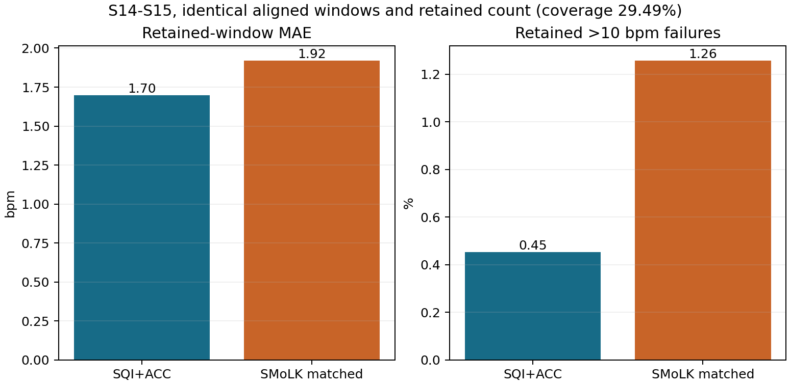

# 伪影识别如何验证心率价值：一次相同覆盖率的比较

> 作品展示草稿；仅供私有仓库存档，公开范围待确认。研究源码已纳入 [源码目录](../research/README.md)，运行条件见 [运行说明](../RUNNING.md)；现存历史材料见 [资料包](../ARTIFACTS.md)，缺失项见 [复现核查](../REPRODUCTION_AUDIT.md)。[返回作品首页](../README.md)

## 研究问题

SMoLK 的分割成绩接近论文后，继续检验它能否替代自主基线中的 SQI＋ACC 筛选。
本案例只选择保留哪些既有心率结果，不修改心率数值，也不重建波形。
拒绝更多困难窗口可能降低留下结果的误差，因此比较时必须同时考虑覆盖率。

## 数据溯源与比较条件

SMoLK 使用 30 秒处理后片段，心率基线使用 8 秒窗口、2 秒步长。
按上游代码重建 DaLiA 的因果带通和 Min-Max，以 1920 个样本的 SHA-256 恢复对应关系。
3436 个训练段和 869 个测试段全部匹配到唯一原始受试者和时间；这是数据溯源，不是波形去噪。
主要比较限定 S14/S15 的 6744 个可映射窗口，S1 因参与规则设计而不进入主结果。
固定心率估计、SQI＋ACC 规则和 seed-0 SMoLK 权重，两种筛选各保留 1989 个窗口。
相同数量不代表相同窗口；主要终点为误差 >10 bpm 的比例，MAE 为次要终点。

## 结果：同覆盖率下，没有支持直接替代

| 方法 | 保留数量 | 覆盖率 | MAE，bpm | 误差 >10 bpm |
|---|---:|---:|---:|---:|
| PPG-only usable | 2234 | 33.13% | 3.309 | 3.894% |
| SQI＋ACC usable/low | 1989 | 29.49% | 1.699 | 0.452% |
| SMoLK 单独排序 | 1989 | 29.49% | 1.920 | 1.257% |

覆盖率分母是本次 6744 个可映射窗口，不是完整原始记录。
同保留数时，SMoLK 的 MAE 增加约 0.222 bpm，大误差比例增加约 0.804 个百分点。
人工伪影标签与频谱心率正确性有关，但目标不同；论文分割指标不能直接替代下游验证。

两图横轴都是筛选方法；左图纵轴为保留窗口的 HR MAE（bpm），右图为误差 >10 bpm 的窗口比例（%）。
两方法各保留 1989 个窗口，覆盖率同为 29.49%；图中没有单独的覆盖率纵轴。
跨段窗口不拼接两个独立标准化片段，不补造缺失 SMoLK 分数。

## 事后探索与边界

在 2234 个 PPG-only usable 窗口中追加二阶段比较，ACC/SMoLK 各保留 1989 个时，MAE 为 1.699/1.671 bpm。
对应大误差比例为 0.452%/0.503%，两项指标未同时改善，受试者方向也不一致。
这些结果只产生互补假设，不能替换主对照，也不属于新数据上的独立验证。
S14/S15 虽未参与 SMoLK 训练，但已用于历史基线评价；两位受试者及重叠窗口限制了推广范围。

## 本项目新增工作与证据留存

建立处理后片段、原始时间及心率窗口之间的精确映射；冻结比较条件并保存逐窗结果。
第一次对照遗漏集合约束后，保留并明确作废 v0；正式结论使用修正后的 v1。
结论限定为当前条件下不支持单独替代 SQI＋ACC，没有据此否定 SMoLK 的其他用途。

执行代码见 [compare_smolk_hr_gating_v0.py](../research/02_论文复现与验证/02_接入自己基线后的验证/01_代码/compare_smolk_hr_gating_v0.py)。文件名保留历史 v0，但当前脚本写入正式 smolk_hr_comparison_v1 目录；它需要先生成冻结规则结果、时间映射和 SMoLK 权重。

以下结果在 02 号资料包中，冻结规则及基线窗口在 01 号包；重算主对照还需要原始 S11–S15 PKL：

- 时间映射：dalia_mapping/summary.json。
- 正式对照：smolk_hr_comparison_v1/summary.json。
- 汇总指标：smolk_hr_comparison_v1/method_metrics.csv。
- 逐窗对齐：smolk_hr_comparison_v1/aligned_windows.csv。
