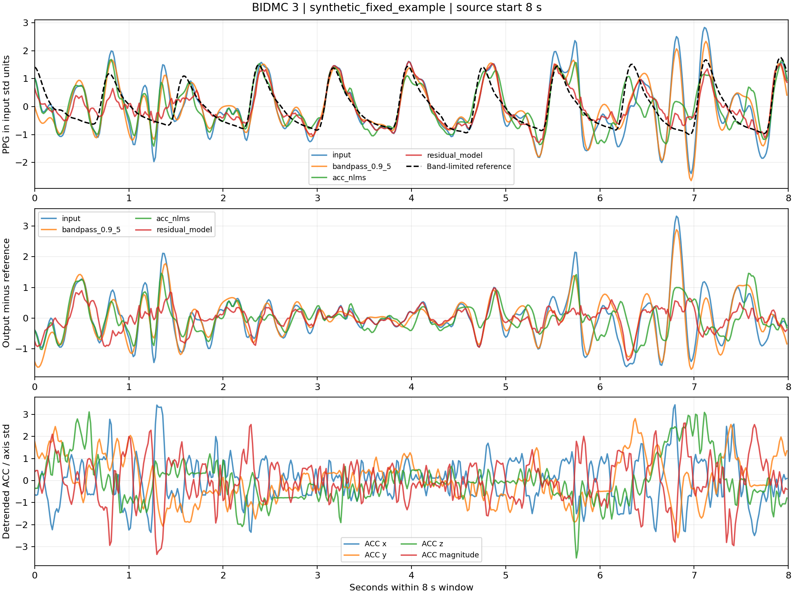
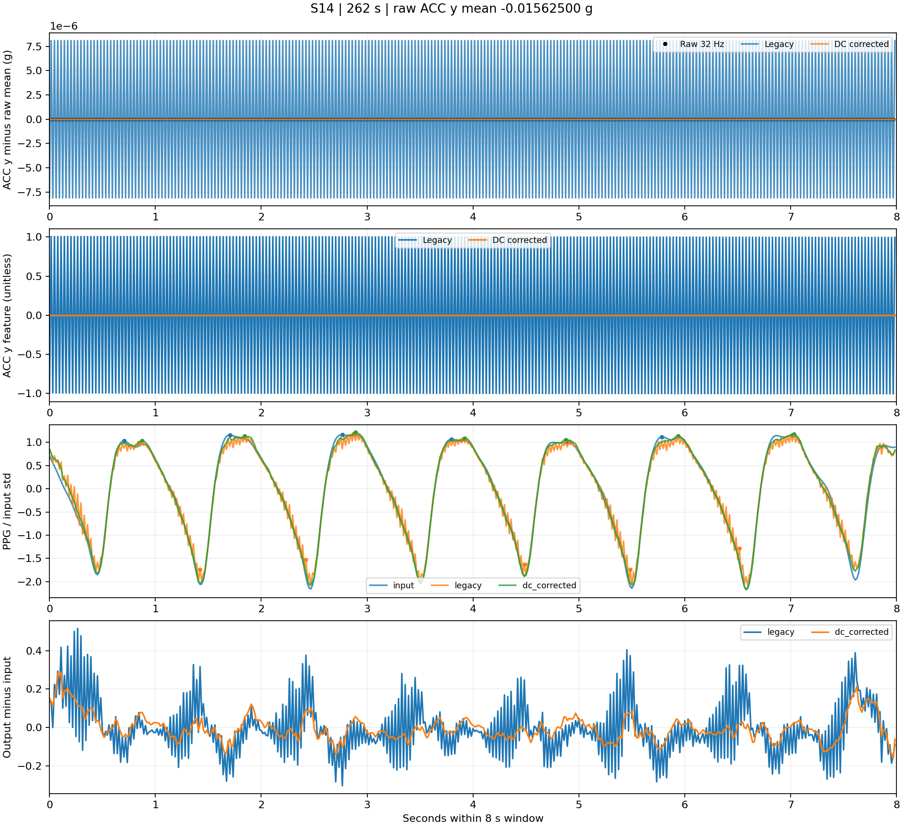

# 合成去噪为何没有直接变成真实逐搏恢复

> 作品展示草稿；仅供私有仓库存档，公开范围待确认。研究源码已纳入 [源码目录](../research/README.md)，运行条件见 [运行说明](../RUNNING.md)；完整历史实验记录仍保留于本地。[返回作品首页](../README.md)

## 研究问题与方法演进

基线与 SQI＋ACC 主要判断哪些结果可信，SMoLK 识别哪些点可能有伪影；本阶段研究怎样修改受污染波形。
同时检查波形误差、心率、峰保持和无新增污染时的副作用，避免把平滑外观或主频改善当成逐搏恢复。

| 阶段 | 方法与假设 | 观察 |
|---|---|---|
| V0 | ACC-NLMS 估计相关分量，SMoLK 分数控制混合 | 峰间 HR 恶化，相关成分并不都适合删除 |
| V1 | 连续处理与 SMoLK/ACC 双门控 | S1 选型选择不重建，最终旁路 |
| V2 | BIDMC 参考＋人工污染，训练残差网络 | 合成改善，真实静坐失真 |
| V3 | 换用筛选的 E4 参考，增加低 HR 覆盖 | 仍未满足保真与真实回归要求 |
| ACC 推理修正 | 固定 V3，校正常量重采样响应 | 部分 HR 指标改善 |
| 一致性重训 | 固定 PPG、目标、污染和模型，仅换 ACC 特征 | 额外收益很小，按固定规则结束 |

V0/V1 使用 6744 窗，V2 以后使用 6682 窗，预处理也不同；不能直接跨版本相减宣称提升。

## 数据与模型

V2 的带限参考来自 BIDMC，ACC 供体来自 PPG-DaLiA；不是同步测量的污染—干净波形配对。
训练/验证/测试分别有 847/345/163 个参考窗，对应 32/7/6 位患者。
先按患者划分，再各生成 identity、10 dB、0 dB、−5 dB；同参考四个版本及 ACC 供体按集合隔离。
ResidualPPG 为本项目的 5393 参数原型，输入 PPG＋ACC x/y/z/模长，以输入减去估计残差作为输出。
使用逐点 L1 训练、验证集选权重；输入与目标共用污染输入均值和标准差，输出不再缩放贴合参考。
V3 使用 S2–S9 训练、S10–S11 验证、S12–S13 配对评价、S14–S15 真实评价。
参考域、HR 分布、样本数和更新次数同时变化，因此 V3 不是只改变设备的单因素实验。

## 结果与不同证据的含义

| 同一实验内的指标 | 输入/旧方案 | 输出/新方案 |
|---|---:|---:|
| V2，0 dB 合成 NRMSE | 1.000 | 0.554 |
| V2，0 dB 合成频谱 HR MAE | 6.853 bpm | 1.823 bpm |
| V2，真实频谱 HR MAE | 12.399 bpm | 7.606 bpm |
| V2，真实峰间 HR MAE | 11.323 bpm | 13.024 bpm |
| 固定 V3，旧 ACC→校正 ACC，峰间 HR MAE | 9.392 bpm | 7.733 bpm |
| 校正 ACC，旧权重→重训，峰间 HR MAE | 7.733 bpm | 7.692 bpm |
| 同次重训对照，identity 峰 F1 | 0.910 | 0.897 |

NRMSE 是波形 RMSE 除以参考标准差；HR MAE 是逐窗绝对误差均值；峰 F1 统计一对一匹配的峰。
V2 合成 HR 参考来自参考 PPG 检峰，真实 HR 参考来自 ECG 导出标签，不是同一种参考定义。
主频接近参考不保证局部峰的位置和数量正确；V2 identity NRMSE 从 0 变成 0.112，说明还存在不必要修改。

横轴为窗口内秒数；上层波形共用污染输入标准差尺度，黑虚线为带限参考，中层为各方法减参考。
底层为 ACC 各列去趋势后除自身标准差，非 g 单位。此图展示人工污染，不是真实运动干净真值。

## 定位 ACC 预处理异常

32→64 Hz 重采样的极小常量响应波纹，可能被逐窗标准化放大成明显特征。
沿原始 ACC、重采样、去趋势、标准化及模型输出逐层核查，采用 L(a)/L(1) 校正。
L 表示相同重采样操作；常量 a=C 时，由线性关系 L(a)=C·L(1)，相除后保持常量。
这解释了修正依据，不代表所有动态信号都完全无失真；实现先处理完整记录再切窗。

横轴为窗口内秒数；第一层是减原始均值的 ACC y，单位 g；第二层为标准化特征。
第三层是共同输入尺度的 PPG 与检峰；第四层为输出减输入，零表示未修改，不表示等于干净真值。
固定权重比较旧/校正/零 ACC，随后复算 5092 条旧特征，仅替换 ACC，保持原合成污染并重训 20 轮。
一致性重训共 860 次更新，170 项预定开发检查中 21 项未通过；这个计数不是准确率。

## 本项目贡献与结论边界

新增工作包括配对数据追溯、传统与学习方法对照、多种评价、ACC 数值问题定位和分步控制变量验证。
研究代码按原文件结构收录于 [第三阶段源码](../research/03_波形重建预研究/01_代码/)；配置、样本清单、逐窗指标、权重及完整固定样例仍保留于本地。本轮结束后未按已看过结果追加调参。
真实数据缺少同步干净 PPG 形态参考；ECG–PPG 延迟校准未通过，未获得有效真实逐搏评价。
相对输入的新增/丢失峰不是 ECG 真值错误率，当前不能声称已验证 HRV。
重叠窗口不是独立受试者；S12–S15 已参与历史开发观察，后续独立验证需要新受试者或新批次。
UniCardio/SSA 仅有有限探索记录，未找到独立完整工件，不列为完整复现成果。
当前沉淀是合成恢复原型和可追溯失败分析，不能把真实失败唯一归因于数据或模型。

## 证据留存记录（未随包提供）

- V2 评价说明：V2/evaluation/README.md。
- V3 执行前方案：V3_单轮验证方案.md。
- ACC 修正说明与结果：ACC预处理修正V1/README.md。
- 数值检查代码已收录：[test_acc_preprocessing_v1.py](../research/03_波形重建预研究/01_代码/test_acc_preprocessing_v1.py)。
- 一致性重训约定：ACC训练推理一致性V1_实验约定.md。
- 最新评价摘要：ACC训练推理一致性V1/evaluation/summary.json。

上述条目用于标明结果出处。V2 配对准备、训练、评价和 ACC 数值测试的运行入口见 [运行说明](../RUNNING.md)；V3 与 ACC 一致性回放另需说明中列出的历史工件，不表示克隆源码即可复现全部历史结果。
